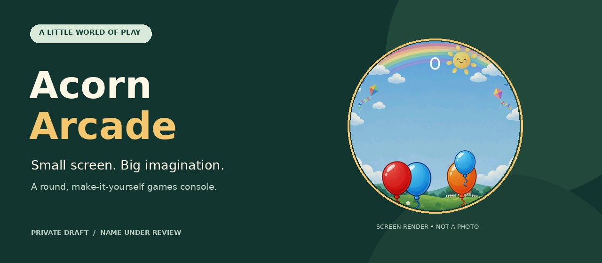
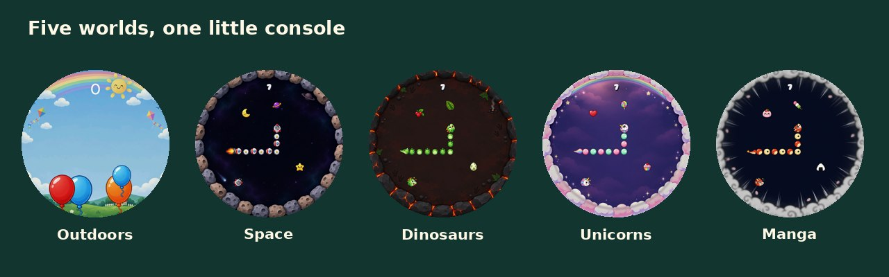
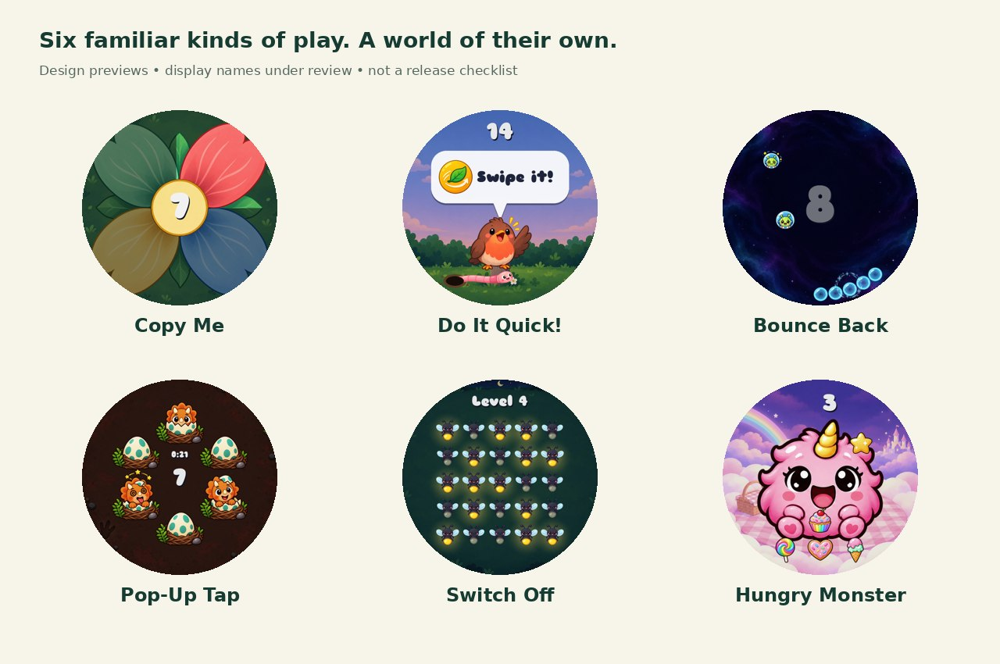

# Acorn Arcade

**Small screen. Big imagination.**

A little round games console for curious hands — and grown-ups who like making things. Built around an ESP32-S3 and a colourful 1.75-inch AMOLED touchscreen, it brings together bite-sized Lua games and illustrated worlds.

> **Experimental DIY project · updated 2 November 2026.** Images below are screen renders and design previews, not product photographs. Acorn Arcade is a working name; see the naming and licensing notes below.

## A little world of play

Tap balloons, guide a snake and explore short, friendly activities on a small touchscreen. Themes change the scenery while keeping each game's identity consistent.

**Five illustrated worlds:** Outdoors, Space, Dinosaurs, Unicorns and Manga. The new compressed theme packs cover all ten games and have passed host tests. Their public rollout follows confirmation of firmware 6 on the development console; these previews are not a claim of hardware testing in every theme.

## Project status

This is an experimental DIY project, not a finished consumer toy or a complete public firmware kit.

| Area | Current status |
|---|---|
| Firmware | **Firmware 6 published** as a signed update for the existing development console. On-device verification is next. |
| Games | Ten games implemented and host-tested across all five themes; the full library rollout follows the firmware update. |
| Storage | Compressed artwork, space checks and PIN-protected game removal, with saved data kept by default. |
| Downloads | Signed game/theme downloads and Wi-Fi firmware updates. |
| Recovery | An earlier deliberate crashing-update test returned to the previous firmware, retaining games and settings. |
| Next | Hardware verification, full theme/game rollout, learning games and a parent app. |

### Updating an existing console

Keep the console charging, then open **Settings → Update firmware**. After restarting, check that About shows **Firmware 6** and allow a full minute for the update to confirm itself.

The firmware is published first with the existing compatible packs. Compressed version-6 themes will follow after on-device confirmation. **Do not install version-6 themes on older firmware.** See [update and recovery steps](STEPS.md).

Firmware 6 passed an ESP32-S3 target build, independent review, host game/layout tests, signature checks and storage/power-cut simulations. Real-device timing, free memory and the firmware-6 OTA still need confirmation; host tests are not hardware tests.

## Games taking shape

The ten-game library includes **Snake, Balloons, Tilt, Pet, Copy Me, Do It Quick!, Bounce Back, Pop-Up Tap, Switch Off and Hungry Monster**. It combines memory patterns, quick reactions, paddle play, pop-up tapping and puzzles. The gallery shows design previews; the expanded public game/theme rollout is pending. Display names stay consistent across themes, while internal pack IDs preserve installed-game and save compatibility.

Letter activities, counting and matching pairs are also on the ideas list.

## Hardware and building

The development console uses the **Waveshare ESP32-S3-Touch-AMOLED-1.75C / 32 MB configuration**. You will also need a USB data cable and a computer.

The 1.75 and 1.75C variants have different pin assignments and flash sizes. Their firmware must not be treated as interchangeable.

A reproducible public build still needs the complete firmware source, pinned dependencies, board configuration, partition layout and verified build/flash instructions. The published firmware is an update for an already provisioned development console, not a complete first-flash kit or a one-command build. Assembly and flashing are adult tasks; supervise use of experimental hardware.

## Local play, connected downloads

Installed games are designed to run on the console. Wi-Fi is used for setup and downloads. Settings, saved progress and play-duration records may be stored locally; download services can receive ordinary connection information such as an IP address.

No advertising is planned in the game experience. A future contribution programme will prohibit tracking and collection of children's information. A parent app and remote approval features are proposals, not current services.

## Updates and security

Game packs and the catalogue use cryptographic signatures. Firmware downloads are checked against a signed catalogue, hash and signature. These checks help reject altered or unauthorised downloads; they do not establish that approved code is bug-free.

Games use a restricted Lua host. Review and resource limits still need real-hardware testing. Development builds have trusted both test and release keys; retiring test-key trust and documenting recovery remain release tasks. Private signing keys must never be included in source, pull requests or untrusted CI jobs.

## Contributing games

The community submission process is being prepared. A proposed game should include:

- Lua source and a manifest.
- Preview images and clear play instructions.
- Creator, source and licence details for every image, font and sound.
- Notes on memory use, saved data and theme support.

The intended route is **pull request → rights and code review → hardware playtest → maintainer signing and release**. Automated checks are planned, not operational. A merged pull request would not automatically publish a game.

Submissions should contain no ads, tracking, purchases, chat or external links, and should use independently created or appropriately licensed code, artwork and audio.

## Names, artwork and licensing

**Public branding is not yet cleared.** [Acorn Arcade](https://www.acornarcade.com/) already has live games-related use. Copy Me, Bounce Back, Switch Off and Hungry Monster also have relevant existing uses. The new display names are implemented in firmware 6; internal game IDs are unchanged. UK, EU and US registry checks remain incomplete.

Game ideas and rules are distinct from protected code, artwork, audio and presentation. Renaming a game does not resolve copied expression or trade-dress concerns.

**MIT is proposed for original project code**, but the authorised copyright notice and actual licence grant still need to be added. Do not infer a blanket licence from this README. See [third-party notices](THIRD-PARTY.md). Third-party components retain their own terms, including LVGL/Lua (MIT), libsodium (ISC), Sniglet/Nunito fonts (SIL OFL), and Tilt-a-tron-derived code (MIT). The final dependency and notice audit is unfinished.

Development illustrations include AI-assisted/generated artwork. Per-file provenance, reference permissions and redistribution rights remain under review; exclusive copyright is not promised. No affiliation with other game or computer brands is implied.
